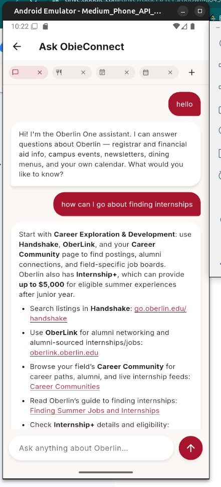
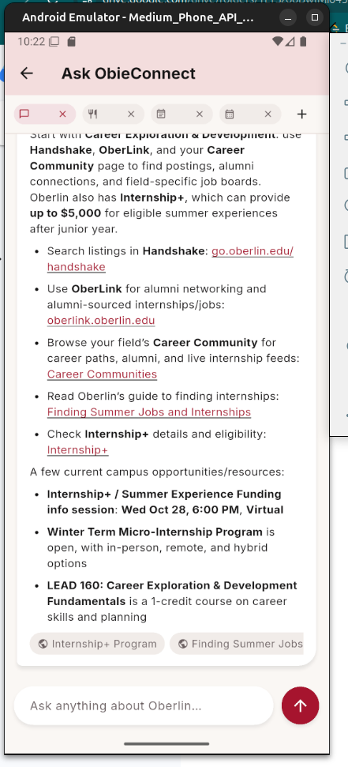
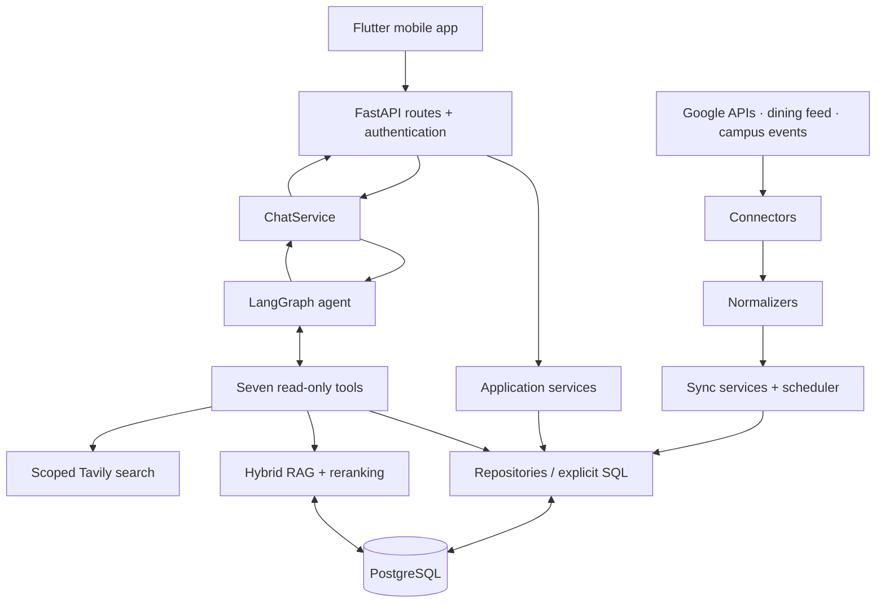
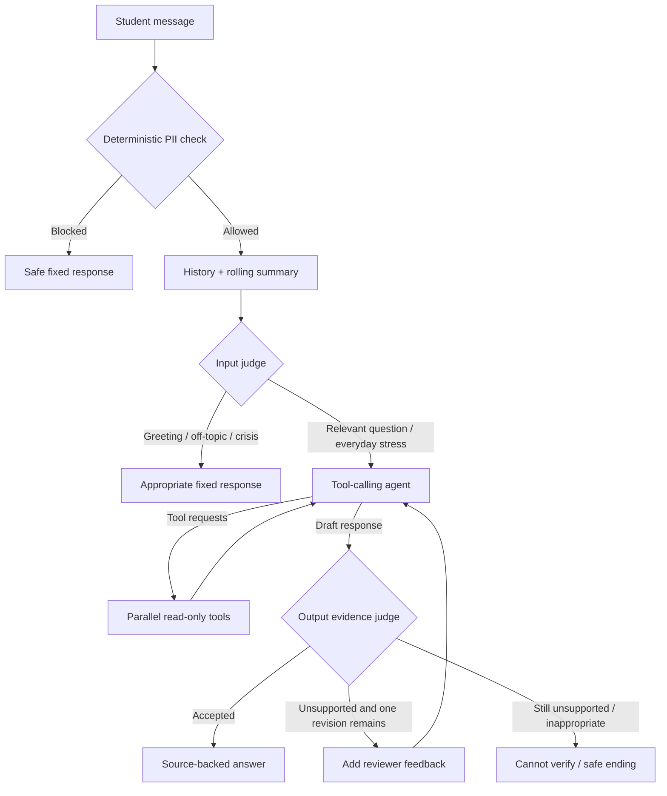
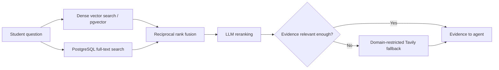

# ObieConnect — AI Architecture Showcase

**A mobile student companion that unifies campus information, events, dining, email, and calendars through a source-grounded AI assistant.**

> **Architecture showcase, not an open-source release.** This repository contains design documentation and app screenshots. The underlying application code is kept in a separate private repository. No API credentials, student data, or institution-managed integrations are included here.

## Why I built it

A student might check an academic website for a deadline, Gmail for an announcement, Google Calendar for their schedule, a dining site for meals, and a separate events page to find something to do. These systems work individually, but they are fragmented from the student's perspective.

**ObieConnect brings those experiences together.** Its Flutter app combines familiar campus tools with an AI assistant that can answer questions using university information and permitted personal context. Instead of offering generic advice, it can point students toward specific resources, dates, and source links.

The **broader application was used by more than 1,000 students**. This repository focuses on the engineering behind its AI assistant and the backend that supports the mobile experience; it does not claim that every app user interacted with the AI feature.

## See it in action

A student asks, **“How can I go about finding internships?”** ObieConnect responds with Oberlin-specific resources—including Career Exploration & Development, Handshake, OberLink, and Internship+—rather than a generic list of job-search tips.

| Student question and response | Source-linked answer and campus opportunities |
| :---: | :---: |
|  |  |

**Architecture diagram:** [Original LangGraph design sketch](architecture/LangGraph_Design.png). The implemented graph has since evolved, including an explicit revision node and additional input-handling logic; the Mermaid diagram below represents the updated flow.

## Tech stack

| Layer | Technologies and approach |
| --- | --- |
| Mobile client | **Flutter / Dart**, Provider, GoRouter; Android running and demonstrated |
| API | **Python 3.12, FastAPI, Pydantic**, asynchronous request handling |
| Database access | **SQLAlchemy Core** with explicit SQL, **asyncpg**; no ORM models |
| Persistence | **PostgreSQL**, JSONB, raw SQL migrations |
| AI orchestration | **LangGraph `StateGraph`** and LangChain models/tools |
| Search / RAG | **pgvector**, HNSW cosine index, PostgreSQL full-text search, reciprocal rank fusion, LLM reranking |
| Integrations | **Google Calendar, Gmail**, Oberlin event listings, Nutrislice dining data, Tavily |
| Identity | **Google OAuth**, server-issued JWT sessions, secure token storage in Flutter |
| Background jobs | **APScheduler** in-process synchronization with freshness checks |
| Tests | **pytest** with fake models/repositories; Flutter unit and widget tests |

## System architecture

ObieConnect has **two closely related systems**: a conventional backend that connects and normalizes campus data, and an AI agent that uses those services to answer questions reliably.



The separation matters: **the LLM does not directly own authentication, database queries, or data synchronization**. Routes authenticate the request; services implement workflows; repositories handle persistence; connectors communicate with external systems; and the agent chooses among deliberately scoped tools.

### Backend organization

The following is a **selected directory map** of the private codebase, not a promise that these files are included in this public showcase:

```text
backend/
├── app/
│   ├── api/
│   │   ├── routes/              # auth, chat, calendar, today, sync,
│   │   │                       # discover, dining, saved, onboarding, profile
│   │   └── deps.py              # authenticated user resolution
│   ├── ai/
│   │   ├── agent/               # LangGraph nodes, state, tools, citations
│   │   ├── rag/                 # ingestion, hybrid retrieval, reranking,
│   │   │                       # structured calendar PDF extraction
│   │   └── newsletter_ingest/   # trust checks, cleaning, extraction, upserts
│   ├── auth/                    # OAuth flow, JWT sessions, token encryption
│   ├── connectors/              # Google Calendar, Gmail, dining, events
│   ├── normalizers/             # external payloads -> normalized DB records
│   ├── services/                # chat, sync, display, calendar writes,
│   │                           # background jobs and business logic
│   ├── repositories/            # SQL reads/writes and user-scoped access
│   ├── schemas/                 # request/response and domain contracts
│   └── db/                      # engine and session setup
├── migrations/                  # hand-written *.up.sql / *.down.sql
└── tests/                       # isolated backend and agent tests

oberlin_one/
└── lib/
    ├── pages/                   # Today, Discover, chat and onboarding screens
    ├── widgets/                 # source cards, chat tabs, calendar, dining, etc.
    ├── repositories/            # mobile API access
    ├── services/                # OAuth deep-link / token persistence
    ├── state/                   # Provider-backed view models
    └── routing/                 # GoRouter navigation and authentication gates
```

#### How a source reaches the app

1. A **connector** fetches information from an external provider such as Gmail, Google Calendar, a dining feed, or the Oberlin events website.
2. A **normalizer** converts source-specific payloads into consistent records. For example, scraped events are cleaned and their local timestamps converted to UTC.
3. A **sync service** handles incremental updates, errors, and reconciliation, calling **repositories** to persist records in PostgreSQL.
4. API **services** expose purpose-built views such as today's calendar, unread emails, menus, and upcoming events to Flutter.
5. The **agent** accesses the relevant stored information through *read-only* tools when a student asks a question.

This design lets the mobile interface and the assistant reuse the same integration work without giving the language model unrestricted access to external accounts.

### Real backend workflows

| Workflow | Main backend behavior |
| --- | --- |
| **Google sign-in** | OAuth callback establishes a server session; authenticated requests resolve the user's identity from a cookie or bearer JWT. Android receives its login through an app deep link. |
| **Calendar sync** | Incremental Google Calendar `syncToken` updates and cancellation handling; calendar creation is a **separate, confirmation-gated** operation. |
| **Gmail sync** | Incremental `historyId` updates, recovery when history has expired, and backoff for recognized quota/rate-limit responses. Personal email remains user-scoped. |
| **Dining** | Nutrislice menu data is normalized by location, meal period, item, and dietary tags; the app serves both compact daily previews and detailed menus. |
| **Campus events** | Events are parsed from Oberlin's date-specific HTML listings, normalized, and exposed through Discover filters and personalized categories. |
| **Background refresh** | An in-process APScheduler runs the existing sync services, with per-source freshness checks and per-user error isolation. |
| **Chat** | Persistent per-user sessions, independent tabs, rolling conversation summary, and status updates while the agent works. |

The public [backend architecture walkthrough](docs/backend-architecture.md) covers the request paths, database design, security boundaries, and engineering trade-offs in more detail.

### Selected API endpoints

These are examples of implemented routes in the private FastAPI service—not a public API offered by this repository.

| Endpoint | Purpose |
| --- | --- |
| `GET /today/calendar` | Calendar items for a requested date window |
| `GET /today/gmail` | Recent unread email snapshot for the signed-in student |
| `GET /today/dining` | Dining options for a chosen day |
| `GET /discover/events` | Upcoming events filtered by date/category/preferences |
| `POST /calendar/events` | Add a calendar event after explicit user confirmation |
| `POST /sync/google-calendar`, `POST /sync/gmail` | Refresh connected Google data |
| `GET /chat/sessions` | Restore persisted chat tabs |
| `POST /chat/sessions/{id}/messages/stream` | Run the agent, emit progress, then return the verified result |

## The LangGraph agent

The assistant is a **stateful tool-calling system**, not a single retrieval prompt. The graph explicitly handles privacy checks, request classification, evidence gathering, output verification, and bounded correction.



**Seven available tools:** `get_date_context`, `search_oberlin_info`, `search_newsletters`, `search_events`, `get_calendar_events`, `get_dining_menu`, and `web_search_oberlin`.

- The agent can choose multiple independent lookups and run them concurrently.
- The tool budget is **six calls per turn**, with **at most one revision** following output verification.
- Per-user tools obtain `user_id` from the **authenticated server configuration**, never from a model-generated argument.
- Source references and suggested actions are returned as structured artifacts rather than letting the model invent UI metadata.
- The agent **cannot search an arbitrary student's personal emails**. A separate Gmail feature displays the signed-in student's inbox snapshot, and a trusted newsletter pipeline contributes approved announcements to shared retrieval.

### Conversation persistence and streaming

`ChatService` connects the graph to persisted `chat_sessions` and `chat_messages`. Each chat tab has its own history. The agent receives the last **six turns** and a rolling summary of older turns. The UI can show progress such as *“Searching Oberlin pages…”* or *“Checking the answer…”* while it waits.

I chose to **stream progress events, not unverified draft tokens**: the response becomes visible only after the output judge checks it against retrieved evidence. Failed agent turns are not saved as successful conversations.

## Hybrid RAG: exact terms and meaning

The retrieval system moved from a separate Pinecone-based pipeline to a **single PostgreSQL knowledge store**, reducing duplicated infrastructure while supporting both semantic and keyword retrieval.



- **Storage:** one `rag_chunks` table for website content and admitted campus newsletter items.
- **Dense search:** 1,536-dimensional embeddings indexed in pgvector with **HNSW cosine** similarity.
- **Keyword search:** PostgreSQL `tsvector` + GIN index, ranked with `ts_rank_cd` (**not BM25**).
- **Fusion:** combine the top 20 dense and top 20 full-text hits using **reciprocal rank fusion**.
- **Rerank and gate:** a smaller model reranks the fused candidates; a relevance threshold determines whether the index is sufficient or a scoped live search is needed.
- **Source-aware chunking:** website sections carry `Title › Heading` context; academic calendar PDFs are represented **one event/date row per chunk** and checked for weekday inconsistencies.

**Development index snapshot (October 2026):** approximately **3,200 campus pages / 19,600 website chunks**, plus **530 newsletter chunks**. These are documented development counts, not a live production-corpus guarantee.

### Trusted newsletter ingestion

Newsletters enter the shared index through a **separate pipeline** from personal Gmail sync:

`Designated mailbox → sender authentication + allowlist → HTML cleanup → admission judge → structured item extraction → deduplicated upsert → shared RAG search`

The pipeline verifies sender signals, excludes personal one-to-one conversations, and uses an admission judge that **fails closed** when it cannot decide if content belongs in the shared knowledge base. Emails and webpages are treated as **untrusted data**—not instructions to the model.

## Guardrails and reliability

I deliberately combined deterministic logic with model-based checks where each is appropriate:

1. **Before model calls:** reject or redact particularly sensitive identifiers (specifically SSNs and Luhn-valid card numbers); this is not a comprehensive PII detector.
2. **Input classification:** route greetings, off-topic questions, everyday academic stress, and urgent crisis requests differently.
3. **After generation:** compare factual claims with tool evidence. Unsupported claims trigger one revision or an explicit *“I couldn't verify this”* outcome.
4. **At the authorization boundary:** enforce session ownership and account-scoped access in the backend, independently of what the model asks for.
5. **At the retrieval boundary:** restrict external search domains and avoid following instructions embedded in retrieved content.

A limitation worth being transparent about: the output judge **fails open during a judge outage** in the documented implementation. That trade-off favors availability over strict verification and would need re-evaluation for higher-risk settings.

## Engineering results and lessons

| Observation | What changed / what it demonstrated |
| --- | --- |
| **Retrieval quality** | In a small **22-question, hand-written smoke set**, reranking improved hit@1 from **13/18 to 17/18** and blocked **4/4** out-of-corpus questions. This is exploratory, not a formal benchmark. |
| **Hallucination failures** | The agent invented details such as sports scores and academic information during testing; those incidents motivated claim-level output checks and stricter parsing of source tables. |
| **Latency** | Typical recorded responses took **4–10 seconds**, with harder queries taking **12–19 seconds**; parallel tool calls and progress streaming improved the experience. |
| **Authentication issues** | Real mobile tests caught repeated OAuth callback handling and state-related retry problems, prompting idempotency and duplicate-launch guards. |
| **Test strategy** | Hundreds of backend unit/graph tests and Flutter unit/widget tests use fakes at external boundaries. Test suites do **not** make live model calls. |

I prioritized **source-grounded answers, predictable failures, and explicit scope** over claiming the model can do everything. The project taught me how to join traditional backend engineering with agent orchestration, retrieval evaluation, and usable mobile UX.

## Current scope and known limitations

- **Android is demonstrated.** The Flutter project has iOS code, but its Google OAuth deep-link registration is not yet completed on iOS.
- Campus crawling is not yet fully scheduled; retrieved information can become stale between refreshes.
- The chat agent is **read-only**. The broader app supports confirmed Google Calendar creation, but the agent does not autonomously alter calendar events or register for classes.
- The shared newsletter index uses an approved source mailbox; it is **not** a pooled index of students' private mailboxes.
- Image-only flyers, private Gmail question answering, and cross-session AI personalization are not implemented.
- Relevance thresholds and output judges still need a larger, labeled evaluation dataset.
- API/model credits are required for live AI requests; a permanently available public demo is not guaranteed.

## Explore the design

- [Original LangGraph design](architecture/LangGraph_Design.png)
- [Backend architecture and integration flows](docs/backend-architecture.md)
- [View Flutter App Screenshots](./screenshots/)


**Why make this public?** The application code and real user data remain private, but the architecture, trade-offs, and engineering lessons are worth sharing. This is a portfolio-grade overview of how I built an AI feature inside a full-stack mobile product—not a runnable starter template.
