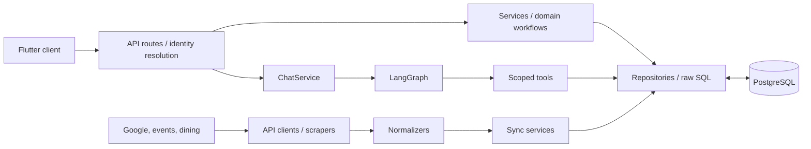

# Backend Architecture — ObieConnect

This document describes the **implemented backend and its design decisions** at the time of the October 2026 development notes. It is an architecture explanation, not the private application's source code or deployment instructions.

[← Back to README](../README.md)

## 1. Architectural approach

The API uses **Python 3.12 + FastAPI** with an async PostgreSQL persistence layer. Database access is through **SQLAlchemy Core with explicit SQL over asyncpg**. There are **no SQLAlchemy ORM models** and **no Alembic migrations**; schema changes use hand-written `.up.sql` / `.down.sql` files.

The principal responsibilities are separated:

| Area | Responsibility | Representative modules |
| --- | --- | --- |
| HTTP surface | Request validation, authentication dependencies, endpoint responses | `app/api/routes/`, `app/api/deps.py` |
| Schemas | Typed API and model contracts | `app/schemas/` |
| Services | Workflow orchestration; read/write use cases | `app/services/` |
| Repositories | Parameterized explicit SQL and persistence | `app/repositories/` |
| Connectors | Google APIs, Nutrislice, university events listing | `app/connectors/` |
| Normalizers | Convert external formats to consistent database structures | `app/normalizers/` |
| Identity | Google OAuth, JWT session, token encryption | `app/auth/` |
| AI agent | LangGraph state, nodes, tools, citations | `app/ai/agent/` |
| Retrieval | Website/PDF ingestion, pgvector, full-text, reranking | `app/ai/rag/` |
| Newsletter pipeline | Authentication, allowlist, admission check, extraction | `app/ai/newsletter_ingest/` |

## 2. Authentication and data ownership

**Google OAuth** connects the app to user-approved Google services. Browser sessions use a secure session cookie; mobile requests can present a **bearer JWT**. The Flutter app handles the Android OAuth redirect via a custom URL scheme and stores the session token with `flutter_secure_storage`.

In API code, `get_current_user_id` resolves the authenticated user. Business logic and personal-data tools use this server-derived ID—not an ID supplied by a language model. Chat sessions verify ownership; requests for nonexistent or other users' conversations get the same not-found behavior.

**Mobile limitation:** iOS OAuth callback registration was not completed in the documented snapshot. The mobile handoff uses a token-bearing deep link; a one-time exchange code would be a stronger future design for reducing exposure in URL histories or logs.

## 3. Data ingestion and synchronization

### Google Calendar

- `POST /sync/google-calendar` invokes `CalendarSyncService` and the Google Calendar connector.
- Sync uses a Google `syncToken`, with handling for cancellations and expired sync state.
- `GET /today/calendar` provides a scoped calendar view. The Flutter app supplies the local-day date window explicitly.
- `POST /calendar/events` uses a separate write service and is called **after explicit user confirmation**, not by the conversational agent.

### Gmail

- `POST /sync/gmail` performs incremental synchronization through Gmail history IDs and stores state in `source_sync_state`.
- When the history window expires, the service clears the stale token and performs a capped recent-message synchronization.
- Recognized rate-limit/quota failures during metadata fetches use bounded exponential backoff; missing or unauthorized messages are handled separately.
- `GET /today/gmail` shows a **snapshot of unread messages received over the last seven days**, newest first. It does **not** imply personal-email Q&A in the agent.

### Dining

The Nutrislice connector fetches menu information by location and menu type. The normalizer retains useful dining fields—meal period, dishes, descriptions, and dietary tags—rather than copying oversized raw payloads. The app provides a compact daily view and a detail endpoint for a specific menu.

### Events / Discover

The Oberlin events site does not supply the JSON API used by this application. Its server-rendered date-specific HTML listings are fetched and parsed by a connector with a separate, testable HTML parser. An events normalizer cleans markup, maps source tags to Discover categories, and resolves local event times. Discover's service applies preferences and date filters when serving the mobile feed.

### Background synchronization

An **in-process APScheduler** calls the same sync services as the explicit sync routes. Per-source freshness guards prevent unnecessary pulls; an error for one user does not stop synchronization for everyone else. This was an intentional single-process MVP choice, not a distributed job architecture. Google push notifications, a queue system, and a cross-instance job store are **not implemented**.

## 4. AI pipeline and tool security

`ChatService` reads the current session's history and rolling summary, calls `run_agent(...)`, and persists the final exchange with source/action artifacts. A separate streaming variant provides status updates during inference.

**Implemented graph order:**

1. **Deterministic PII screening** — blocks SSNs and Luhn-valid payment-card numbers before an LLM receives the input.
2. **Conversation summarization** — keeps the latest six turns and a rolling summary of older ones.
3. **LLM input judge** — distinguishes appropriate questions, greetings, off-topic content, and levels of student distress.
4. **Tool-calling agent** — selects up to six tool calls per turn; independent read-only calls run concurrently.
5. **Output judge** — tests factual claims against retrieved/tool evidence; unsupported drafts can receive one reviewer-feedback revision.
6. **Safe finalization** — verified answer with relevant sources, or an explicit unable-to-verify response where appropriate.

All seven agent tools are **read-only**. The only tool that reads a student's personal data—the calendar lookup—gets the user identity from the server. Tool-returned evidence is separated from display artifacts, and retrieved source text is treated as untrusted input.

The project has a deliberate separation between:

- **Student Gmail synchronization** for the authenticated user's Today card.
- **A designated campus-newsletter mailbox** admitted into a shared RAG index, with sender checks, an allowlist, cleanup, extraction, and a fail-closed admission judge.

No general, cross-user personal email corpus is exposed to the agent.

## 5. Retrieval database and ingestion

The `rag_chunks` table holds both campus website excerpts and approved newsletter items. Dense retrieval uses a **1,536-dimensional pgvector HNSW cosine index**, while exact-term retrieval uses **PostgreSQL `tsvector` and GIN**, ranked by `ts_rank_cd` (not BM25). The two result lists are fused with **reciprocal rank fusion** and a smaller LLM reranks candidates.

When the best reranked passage is insufficient, the university-information tool can fall back to **domain-restricted Tavily**. This is a relevancy gate, not a guarantee of factual correctness; the separate output judge still checks whether the final answer is grounded in evidence.

Document ingestion is structure-aware:

- University pages split primarily by headings, with `Title › Heading` carried into each chunk.
- Long sections use bounded overlap; tiny or heading-only chunks are discarded.
- Academic calendar PDFs are parsed as **one dated row per chunk**, not as indiscriminate text windows.
- Date-to-weekday inconsistencies in source PDFs are flagged rather than silently normalized.

A small development smoke test found that reranking improved top-result retrieval on its selected questions. The team had **not** completed a labeled, representative evaluation set in the documented snapshot.

## 6. Persistence and endpoint examples

### Chat state

`chat_sessions` stores session identity, user ownership, labels, timestamps, and the rolling summary. `chat_messages` stores messages and structured `sources` / `actions` JSONB. Separate conversation tabs in Flutter remain independent, and only the selected tab's messages are loaded when needed.

`POST /chat/sessions/{id}/messages/stream` emits newline-delimited status updates followed by the committed final message. It does **not** stream unverified draft tokens. Model/quota failures are displayed but not persisted as successful conversations.

### Representative routes

| Area | Examples |
| --- | --- |
| Authentication | `GET /auth/google/start`, `GET /auth/google/callback` |
| Connected services | `POST /sync/google-calendar`, `POST /sync/gmail` |
| Daily dashboard | `GET /today/calendar`, `GET /today/gmail`, `GET /today/dining` |
| Events | `GET /discover/events`, `GET /discover/preferences`, `PUT /discover/preferences` |
| Calendar creation | `POST /calendar/events` (confirmation-gated in the UI) |
| Chat | `GET`/`POST /chat/sessions`, `POST /chat/sessions/{id}/messages/stream` |

## 7. Testing and operational boundaries

Unit/graph tests isolate the network and model layers using handwritten fakes, injected model factories, and `httpx.MockTransport`. Live integration checks were run separately against the emulator, local database, and real APIs. Tests were added for observed incidents such as PII replay, unsupported model claims, and chat tab layout issues.

**Known limitations and engineering trade-offs:**

- The original design image predates the `revise` node and progress streaming.
- The output judge fails open on outage in the documented implementation; that choice would require reconsideration in higher-risk deployments.
- Syncing is polling-based and designed for a single backend process.
- Campus content crawls are performed manually; freshness is not guaranteed.
- General personal Gmail Q&A, class registration, image-only flyer extraction, and cross-session AI memory are outside the implemented AI scope.
- The application depends on paid model/API capacity. This public showcase does not contain a deployable backend or demo credentials.

[← Back to README](../README.md)
